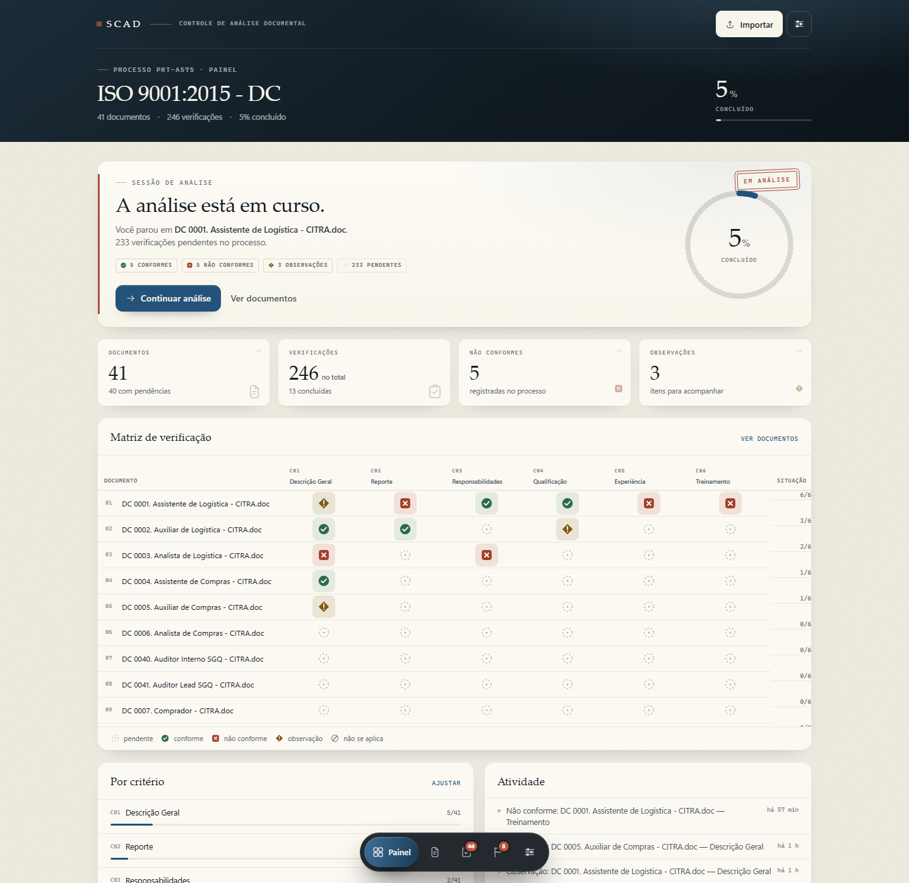

# SCAD — Controle de Análise Documental (v2)

> **Branch `fase-a` — v2 pronta para validação; produção ainda na v1.0 até a janela de deploy.**
> Coleções → Processos, critérios por processo, perfis Sergio/Diogenes, autoria na atividade e documento Ativo/Inativo.

Um caderno de trabalho local para **organizar coleções e processos, importar documentos, verificar critérios, registrar apontamentos e retomar de onde parou** — no notebook e no iPad, pela rede de casa/escritório.

> Decisões de produto, regras de revisão e plano das próximas fases: [PROJECT_MEMORY.md](PROJECT_MEMORY.md).



> Experimento de produto e de interface: valida o fluxo de análise documental (50+ documentos, vários checks por documento) e a linguagem visual descrita em `sistema_interface_reutilizavel.md` e `guia-barra-menu-flutuante.md` — shell, cards, stamps de estado, matriz de verificação e barra flutuante em cápsula.

### Versionamento

- Repositório: `https://github.com/Caiosad10/SCAD.git`
- Estado **v1.0** (produção antes da Fase A): commit `294b890`, tag `v1.0`; bundle de segurança em `backups/scad-v1.0.bundle`.
- `data/`, `backups/` e cópias de QA não entram no Git.
- Push pendente de rede/credenciais:
  ```bash
  git push -u origin master
  git push origin v1.0
  ```
- Próxima fase (schema v2) será feita em branch `fase-a`, testada em cópia e só então mesclada com tag `v2.0`.

### Atualizações (10/11/2026)

- Navegação com **transição suave** entre telas e cápsula com **pílula deslizante**; o shell (cabeçalho e barra) não é mais recriado a cada troca. Links internos usam `history.pushState`: trocar de tela **nunca recarrega** o documento no iPad.
- **Barra que se expande**: ao entrar num processo a cápsula cresce de ~52% até o tamanho final em ~0,7 s, com os ícones surgindo em cascata e a pílula do item ativo já no lugar.
- **Reabertura instantânea**: o estado (e um espelho no `localStorage`) é guardado no navegador; na recarga a tela aparece antes da resposta do servidor e a tela de carregamento só surge se a abertura demorar mais de ~220 ms — em recargas normais ela **não pisca**.
- **Sessão restaurada**: rota, filtros de documentos/apontamentos, escopo da fila (Pendentes/Todos) e rolagem voltam exatamente como estavam ao reabrir o app.
- **Cabeçalho sem repetição**: “Voltar para processos” (com o nome da coleção no `title`), sobrancelha com a tela atual e título no formato **`ISO 9001:2015 - DC`** — coleção e processo sempre visíveis.
- **Painel em cascata**: os blocos do painel entram em sequência a cada troca de tela (sem reanimar quando você salva uma verificação).

### Revisão (Fase B)

- **Diogenes revisa**: no documento concluído ele usa **Aprovar documento** (mensagem opcional) ou **Sinalizar critério** (mensagem obrigatória). Ao sinalizar, os demais critérios avaliados são aprovados automaticamente e o documento fica em **Atenção**.
- Documento com sinalização aberta **não pode ser aprovado**; o Sergio corrige o resultado ou a nota e o critério volta para **Aguardando revisão**.
- Verificação feita pelo próprio revisor já nasce **aprovada**. Documentos concluídos antes da revisão entram como “Aguardando revisão” na migração.
- O revisor tem **fila “Revisão”** na bancada, a **faixa de revisão** no painel e filtros na lista de documentos; cada critério mostra `aprovada`, `sinalizada` e a mensagem de quem sinalizou.
- **Faixa de revisão com papel definido**: “Revisão” aparece com marca-texto cobrindo a palavra inteira e cada contador é um atalho clicável com ícone, número e seta — 👓 **Aguardando revisão** (só o revisor vê), ⚠ **Atenção** (só o analista vê, para corrigir) e ✓ **Aprovados** (abre a lista só com os aprovados).
- **Coluna “Situação” da matriz**: quando o documento está **aprovado, aguardando revisão ou em atenção**, aparece **apenas o ícone** (👓 ⚠ ✓). Nas demais linhas fica a contagem `verificadas/total` (ou “—” para inativo), para saber se tudo foi preenchido. Legenda própria abaixo da matriz.
- Tudo fica no histórico por verificação (autor, mensagem, data) e sai no CSV com as colunas de revisão.

### Presença

- No **painel**, dentro da matriz de verificação, embaixo do nome do arquivo: **“Sergio está aqui”** / **“Diogenes está aqui”**, em letra pequena, só na linha do documento ocupado.
- A linha cresce ~5 px enquanto alguém está no documento e **volta ao tamanho normal** quando a pessoa sai (o alerta some sozinho).
- Funciona por batimento de 12 s (expira em 45 s ao sair) e não grava nada no banco — a presença não aparece na aba “Analisar”.
- **Matriz de verificação** com colunas uniformes, nomes de critério em duas linhas, ícones maiores e fundo tingido por estado. O wrapper que faltava para aplicar o CSS da tabela foi corrigido.
- **Cards de métrica clicáveis**: Documentos, Não conformes (abre apontamentos já filtrados) e Observações (idem). “Verificações” é apenas indicador.
- **Fluxo de verificação contínuo**: ao marcar Não conforme/Observação a nota recebe o foco (sem recarregar a linha), e cada critério tem um atalho “Próximo critério” que rola e foca o seguinte sem sair do documento.
- **Retomada após recarga**: se o Safari/iPad recarregar a página, ela volta ao documento em que você estava, com o mesmo filtro e a mesma rolagem, em vez de abrir no painel.

---

## Como rodar

Precisa apenas de **Node.js 18+** (testado no 24). Não há dependências para instalar.

**No Windows:** dê duplo clique em `iniciar-scad.bat`. O navegador abre em `http://localhost:4177`.

Pelo terminal:

```bash
node server.mjs          # servidor na porta 4177
node server.mjs --open   # abre o navegador também
node server.mjs 4180     # outra porta
```

Para encerrar, `Ctrl+C` na janela do servidor.

---

## No iPad

1. Mantenha o notebook ligado com o servidor rodando, na **mesma rede Wi-Fi** do iPad.
2. Abra o endereço mostrado no terminal (ex.: `http://192.168.56.211:4177`) — ele também aparece em **Ajustes → Acesso no iPad**, com botão de copiar.
3. No Safari, use **Compartilhar → Adicionar à Tela de Início** para abrir como app (ícone e tema próprios).
4. Se o iPad não conectar, permita o **Node.js** na primeira pergunta do firewall do Windows (redes privadas).

Os dados ficam no notebook: o iPad é uma segunda tela de trabalho, não um banco separado.

---

## O fluxo

```text
Criar processo  →  Definir critérios  →  Importar documentos  →  Verificar  →  Apontamentos
```

- **Documentos × critérios = verificações.** 50 documentos × 3 critérios geram 150 checks independentes. Critério que não vale para o processo não deve existir na lista — remova-o nos Ajustes do processo.
- **Estados de uma verificação:** `Pendente` · `Conforme` · `Não conforme` · `Observação`.
  Cada estado tem **forma + rótulo + cor** (círculo, quadrado, losango, círculo cortado), não depende só de cor.
- **Apontamentos** são as verificações marcadas como **Não conforme** ou **Observação**, agrupadas por documento, com a nota registrada.
- **Retomada:** o último documento verificado é lembrado. O botão **Continuar análise** do painel leva direto para ele; a bancada também abre nele.
- **Progresso:** percentual de verificações avaliadas (inclui “não se aplica”), por documento, por critério e no processo.

### Atalhos na bancada (teclado)

| Tecla | Ação |
|---|---|
| `1` `2` `3` | Conforme · Não conforme · Observação |
| `J` / `K` ou `↓` / `↑` | Próxima / anterior verificação |
| `N` | Próximo documento pendente |

Toque também funciona: os botões de resultado têm 42–48 px e a nota abre no próprio check.

---

## Dados, backup e privacidade

- Estado: `data/db.json` (gravação atômica, revisão incremental).
- Arquivos importados: `data/files/` (até ~32 MB por arquivo).
- **Ajustes → Dados e backup** exporta:
  - **JSON** do processo (metadados, critérios, verificações, notas) — não inclui os binários;
  - **CSV** de todas as verificações (abre no Excel/Numbers);
  - restauração de JSON e “apagar tudo”.
- Nada sai da máquina. Não há conta, nuvem nem telemetria. Também não há autenticação: use na rede local, não exponha na internet.

Ao trabalhar em dois aparelhos, o app sincroniza a cada ~12 s (e ao voltar para a aba). As gravações são por verificação — duas pessoas editando verificações diferentes não se atropelam; no mesmo campo, vale a última gravação.

---

## Estrutura do projeto

```text
scad/
├── server.mjs              # HTTP + API + persistência (sem dependências)
├── public/
│   ├── index.html
│   ├── styles/tokens.css   # paleta, tipografia, espaçamento, raios
│   ├── styles/app.css      # componentes, shell, barra flutuante, responsivo
│   └── js/
│       ├── app.js          # rotas, interações, importação, sincronização
│       ├── store.js        # estado em memória + seletores
│       ├── api.js          # cliente da API
│       ├── ui.js           # helpers, stamps, sheets, toasts
│       ├── icons.js        # família única de ícones
│       └── views/          # painel, documentos, bancada, apontamentos, ajustes
├── data/                   # criado na primeira execução
├── shots/                  # capturas de verificação (desktop, iPad, telefone)
└── scripts/                # massa de demonstração e testes (Node/Edge CDP)
```

### API (resumo)

| Rota | Uso |
|---|---|
| `GET /api/state` | estado completo + `rev` |
| `POST /api/process` · `PATCH /api/process` | criar / editar processo |
| `POST|PATCH|DELETE /api/criteria...` · `POST /api/criteria/reorder` | critérios |
| `POST /api/documents` · `PATCH|DELETE /api/documents/:id` | upload base64 e edição |
| `PATCH /api/checks/:id` | `{status, note}` — devolve só o check alterado |
| `GET /api/export` · `POST /api/import` · `POST /api/reset` | backup e limpeza |
| `GET /files/:stored` | arquivo (inline para PDF/imagem, download para o resto) |
| `GET /api/health` | versão + endereços da rede local |

---

## Massa de demonstração

Com o servidor rodando e o processo vazio:

```bash
node scripts/make-demo.mjs
```

Cria **12 documentos sintéticos × 4 critérios = 48 verificações**, com não conformidades e observações de exemplo. Para recomeçar, use **Ajustes → Apagar tudo**.

---

## Testes feitos

| Teste | Resultado |
|---|---|
| `node scripts/smoke.mjs` — API (processo, upload, checks, critérios, export, reset) | 18/18 |
| `node scripts/flow.mjs` — onboarding, importação de 2 arquivos, NC + nota, apontamento, reset | fluxo completo, sem erros de console |
| `node scripts/qa.mjs` — layout em 1440×1000, 1180×820, 834×1194, 1194×834 e 390×844 | 0 falhas, 20 capturas |
| `node scripts/extras.mjs` — critérios pela UI, edição de apontamento, CSV, sincronização entre dispositivos | 6/6 |

O QA mede: overflow horizontal, centralização e `pointer-events` da cápsula, rótulo do item ativo, espaço inferior reservado, elementos além da viewport, alvos de toque e contraste WCAG dos pares de cor.

---

## Decisões de interface (o experimento)

- **Shell compartilhado:** cabeçalho de contexto escuro + conteúdo em papel + navegação flutuante independente.
- **Barra em cápsula:** fixa, centralizada, fundo escuro translúcido com blur, item ativo com ícone + rótulo e gradiente azul-tinta; inativos só ícone; badges de pendências/apontamentos; wrapper com `pointer-events: none` e `<nav>` com `auto`; `padding-bottom` de 116 px no conteúdo (36 px de folga acima da barra no fim da página); `env(safe-area-inset-*)`.
- **Tipografia editorial:** serifada (Iowan/Palatino/Georgia) para títulos e números; sans do sistema para operação; mono para metadados, contagens e carimbos. Sem fontes externas — funciona offline.
- **Stamps e carimbo “em análise”:** estados com contorno quadrado e texto em caixa alta, além de formas geométricas; o cartão de destaque leva um carimbo inclinado, como um documento de arquivo.
- **Matriz documento × critério:** cada célula é um check clicável; funciona como folha de conferência para dezenas de documentos.
- **Sem sidebar no desktop:** mantida a cápsula para testar o componente nos dois tamanhos; a adaptação desktop pode virar sidebar em projetos com mais áreas (como o próprio .md recomenda).
- **Tokens adaptados:** mantida a estrutura semântica do guia, com o gradiente roxo/índigo trocado por azul-tinta para não competir com os estados verde/vermelho/âmbar.

### Limitações conhecidas

- Um processo ativo por instalação (sem múltiplos processos simultâneos).
- PDF no iPad: o Safari pode mostrar só a primeira página em `<iframe>`; o diálogo oferece **Abrir em nova aba** e **Baixar**.
- Sem OCR, sem comparação de versões, sem anexos por apontamento, sem autenticação.
- Não há servidor de produção: é um app local, pensado para uma pessoa e dois dispositivos.

### Próximos passos naturais

1. Múltiplos processos (lista + arquivo) e reabertura.
2. Anexar evidência (print/trecho) ao apontamento.
3. Relatório PDF com cabeçalho do processo e lista de apontamentos.
4. PDF.js para leitura lado a lado no iPad.
5. Autenticação simples/PIN se sair da rede local.
